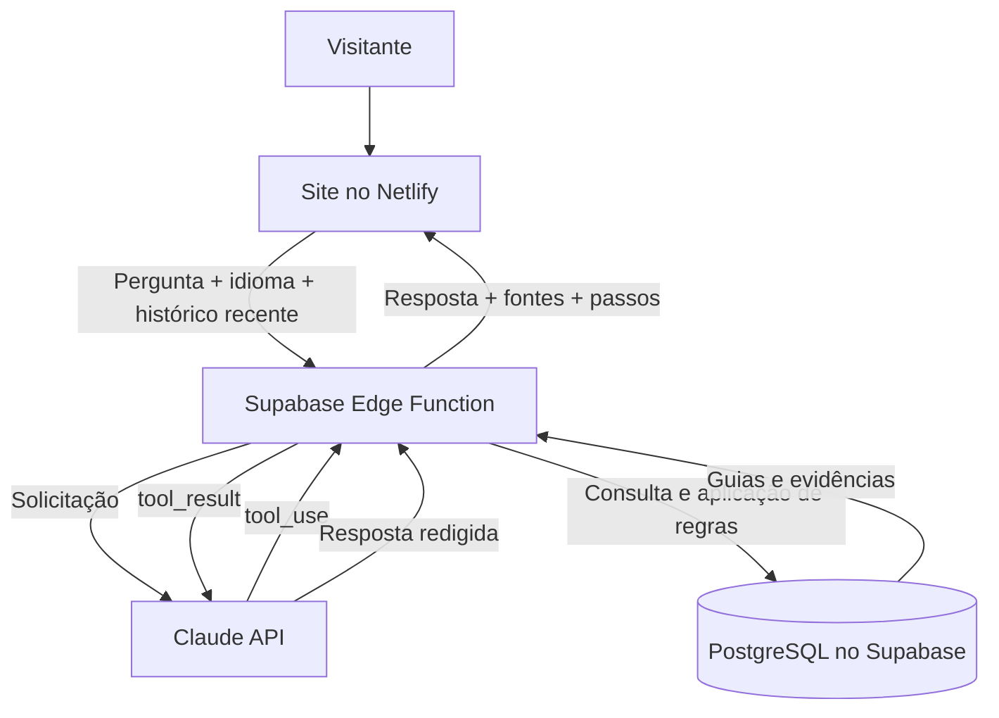

<div align="center">

  

  # 🍻 Karte Assist

  **Seu guia digital para o Oktober Karte da Oktoberfest Blumenau 2026.**

  Um assistente virtual multilíngue que ajuda visitantes a encontrar informações sobre o cartão de consumo, com respostas em linguagem natural e referências documentais.

  [**🌐 Acessar a demonstração**](https://wonderful-cookies-8d6961.netlify.app/) · [**🧠 Entender a arquitetura**](#-como-funciona) · [**💻 Executar localmente**](#-executando-o-frontend)

  
  
  
  
  
  
  

  **Projeto acadêmico independente**, desenvolvido no contexto do Super Dev Challenge 2026. Não é um serviço oficial da Oktoberfest Blumenau.

</div>

---

## 🎯 O projeto

O **Karte Assist** nasceu de um desafio: tornar mais simples o acesso às informações sobre o *Oktober Karte*, cartão utilizado em consumos na Oktoberfest Blumenau.

Em vez de procurar respostas em diferentes páginas, o visitante escolhe seu idioma e conversa com o agente em uma interface inspirada em aplicativos de mensagens. O sistema consulta guias, fontes e regras organizadas em um backend próprio.

### 🌍 Atendimento em quatro idiomas

| Idioma | Interface e atendimento |
|---|---|
| 🇧🇷 Português | Português brasileiro |
| 🇩🇪 Deutsch | Alemão |
| 🇪🇸 Español | Espanhol |
| 🇬🇧 English | Inglês |

### ✨ Principais recursos

- Tela inicial visual com seleção de idioma.
- Interface de chat responsiva para celular, notebook e desktop.
- Conversas em linguagem natural, com continuidade entre perguntas recentes.
- Orientações sobre aquisição, recarga, utilização, saldo, reembolso e suporte.
- Respostas acompanhadas de referências documentais, quando disponíveis.
- Rastreamento das ferramentas utilizadas pelo agente (`tool_use` e `tool_result`).
- Cuidados com dados pessoais e diferenciação entre informações de 2026 e referências históricas.

## 🧠 Como funciona



| Camada | Tecnologia | Responsabilidade |
|---|---|---|
| Frontend | HTML, CSS e JavaScript | Tela de idiomas, chat e comunicação HTTP |
| Hospedagem | Netlify | Publicação do frontend estático |
| Backend | Supabase Edge Functions + TypeScript/Deno | Validação, execução de ferramentas e regras de negócio |
| Dados | PostgreSQL (Supabase) | Guias, fontes, histórico e registros técnicos |
| Inteligência artificial | Claude API (Anthropic) | Interpretação da intenção, escolha de ferramentas e redação |

### Ferramentas do agente

| Ferramenta | Finalidade |
|---|---|
| `buscar_guia` | Consulta orientações documentadas por categoria |
| `consultar_recarga` | Trata canais de recarga e restrições de cadastro |
| `consultar_reembolso` | Aplica regras de reembolso conforme saldo e data |
| `consultar_suporte` | Orienta situações como perda do cartão e casos excepcionais |

O modelo **solicita** a utilização das ferramentas, mas a execução acontece no backend. Ele não tem acesso direto irrestrito ao banco nem permissão para efetuar transações financeiras.

## 🗂️ Estrutura do código

```text
super-dev-challenge-2026/
├── index.html                 # Estrutura das telas
├── app.js                     # Chat, idiomas e chamadas à API
├── style.css                  # Estilos gerais
├── messenger.css              # Interface de mensagens
├── assets/                    # Ilustração e bandeiras
├── supabase/
│   └── functions/
│       └── oktober-karte-assist/
│           └── index.ts       # Lógica do agente na Edge Function
└── README.md
```

O projeto também usa tabelas PostgreSQL configuradas diretamente pelo painel do Supabase. O código da função está versionado neste repositório; publicar esse arquivo no GitHub **não atualiza automaticamente** a função implantada no Supabase.

## 💻 Executando o frontend

Não é necessário instalar React, Angular ou dependências de build para executar o frontend.

```bash
git clone https://github.com/RafaFilastro/super-dev-challenge-2026.git
cd super-dev-challenge-2026
python3 -m http.server 5500
```

Abra `http://localhost:5500` no navegador.

**Observação:** o frontend utiliza uma Edge Function remota configurada em `app.js`. Para executar uma instalação própria, você precisará configurar um projeto Supabase com as tabelas necessárias, publicar a função `oktober-karte-assist` e ajustar seu endpoint no frontend.

## 🔐 Segurança e limites

- A chave `ANTHROPIC_API_KEY` fica nos **Secrets** da Edge Function, nunca no JavaScript público.
- O agente **não acessa saldos individuais**, não bloqueia cartões e não solicita nem executa reembolsos.
- O frontend orienta o visitante a não compartilhar CPF completo, senhas ou dados bancários.
- Informações históricas não devem ser apresentadas automaticamente como procedimentos confirmados de 2026.
- A regra de CPF para recarga online foi tratada como **condição operacional identificada pela equipe**, distinta dos requisitos de reembolso documentados oficialmente.
- As respostas de IA podem conter erros: informações sensíveis e procedimentos excepcionais devem ser verificados com a organização.

> O repositório é público. **Não publique** valores de Secrets, tokens, chaves privadas, credenciais do banco ou backups com dados sensíveis.

## 📌 Sobre o desafio

O Karte Assist foi desenvolvido como protótipo no **Super Dev Challenge 2026**, reunindo frontend web, experiência multilíngue, arquitetura serverless, banco relacional e IA com ferramentas.

Os dados simulados do desafio, identificados por tabelas `ov_`, representam um cenário fictício e não devem ser confundidos com operações financeiras reais da Oktoberfest. A versão de atendimento baseada em guias documentais não pressupõe consulta direta a todas essas tabelas.

---

<div align="center">

**Karte Assist · Super Dev Challenge 2026**

*Ilustração criada para o protótipo, não representação do cartão oficial.*

</div>
